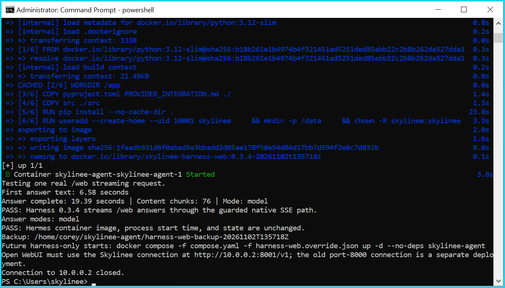
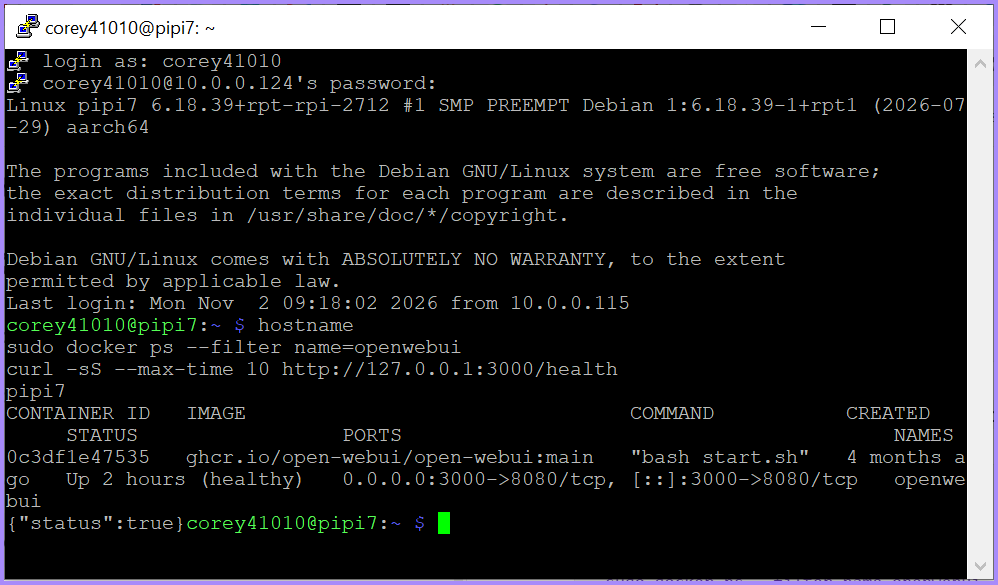
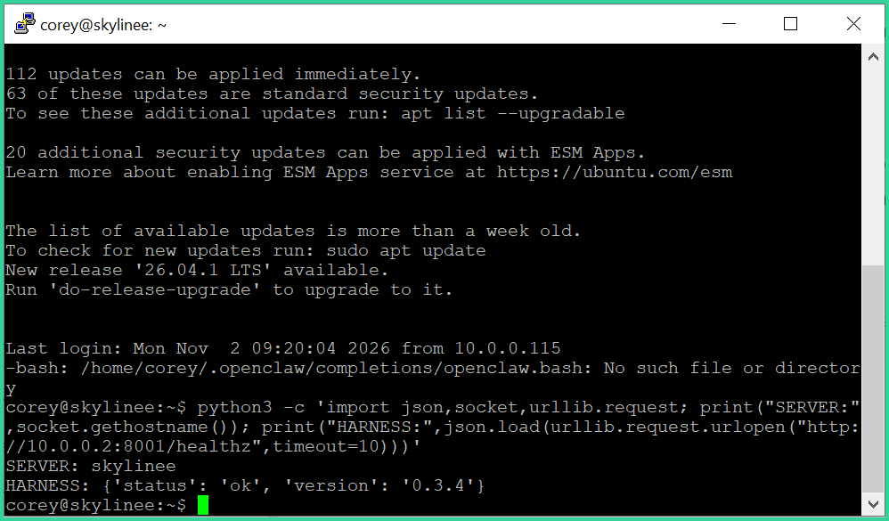

# Live deployment evidence — November 2, 2026

These terminal screenshots document Corey's Skylinee deployment. They are cropped from operator-provided screenshots. Cyan, purple and green borders distinguish the checks; terminal text and pixels inside each crop are unchanged. Browser, desktop and taskbar backgrounds are excluded. No generated terminal content is used.

## Streaming verification

The installer output reports a real `/web` streaming request: first answer text **6.58 seconds**, completion **19.39 seconds**, **76 content chunks**, answer mode **model**. It reports Harness **0.3.4** using the guarded native SSE path and reports that the Hermes container image, process start time and state were unchanged. These timings belong to this captured API test, not a general latency guarantee.

## Raspberry Pi / Open WebUI health

The terminal identifies the host as `pipi7`. Container `openwebui` is shown healthy, with host port **3000** mapped to container port **8080**. A local `/health` request returns `{"status":true}`.

## Ubuntu / harness health

The terminal identifies the host as `skylinee`. The harness health request returns `{'status': 'ok', 'version': '0.3.4'}`. The capture also retains the unrelated shell completion warning visible at login.

## Scope and provenance

These are evidence assets, not a source-code upgrade or a new deployment. The repository's existing 0.6.0 source and the separately deployed Hermes bridge reporting 0.3.4 have different version histories. This commit does not replace the repository's implementation or change production services.

Health responses do not establish every route, tool, skill, or model identity. Separate WebUI captures in the operator's original archive show inconsistent assistant naming; identity stability remains unresolved. The cause of the earlier WebUI 500 response is not established by these health checks.

[manifest.json](manifest.json) records source filenames, crop coordinates, dimensions and SHA-256 hashes. The full desktop originals remain in the operator's preserved screenshot collection; only the terminal crops are published here.

